<div align="center">

<picture>
  <source media="(prefers-color-scheme: dark)" srcset="docs/brand/pennywise-lockup-dark.svg">
  
</picture>

### Your money, kept in your pocket.

**A private personal finance tracker that keeps everything on your device.**

Track spending, plan bills, grow savings and print clear reports, with no bank connection, no account, no server and no tracking.

[**Open the app →**](https://pennywise.studio/app.html) &nbsp;·&nbsp; [Website](https://pennywise.studio) &nbsp;·&nbsp; [Run it locally](#run-it-locally)

[](https://github.com/y-assila/pennywise/actions/workflows/test.yml)


<br>

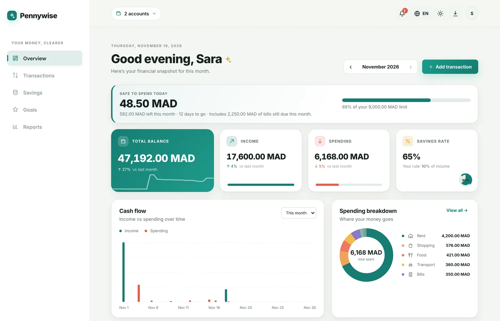

</div>

---

## Why Pennywise

| | |
|---|---|
| 🔒 **Private by design** | Your data is stored in your browser (IndexedDB) and never leaves the device. The app has no backend, no analytics and no outside fonts or scripts. |
| ⚡ **Instant and offline** | Plain HTML, CSS and JavaScript with no build step. Install it as an app and it works without a connection. |
| 🧭 **Shows what is really yours** | Future bills are listed but only count when their date arrives, and "Safe to spend today" already sets aside the bills still due this month. |
| 🌍 **Three languages** | English, Français and العربية, with a full right-to-left layout, and dates and numbers in the chosen language. |

## A tour

<table>
<tr>
<td width="50%">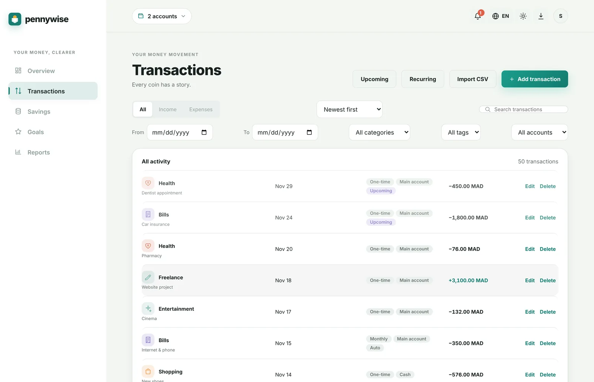</td>
<td width="50%">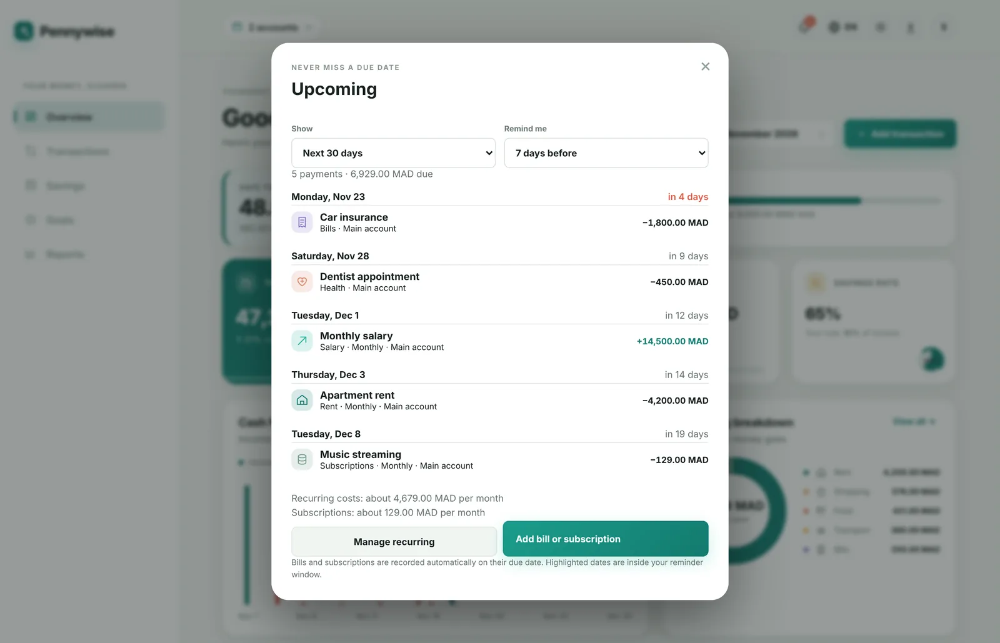</td>
</tr>
<tr>
<td><b>Transactions</b>: search, sort and filter by date, category, tag or account. Future-dated items are marked <i>Upcoming</i>.</td>
<td><b>Upcoming bills</b>: everything due in the next 7 to 90 days, highlighted when it is close, plus your monthly recurring costs.</td>
</tr>
<tr>
<td>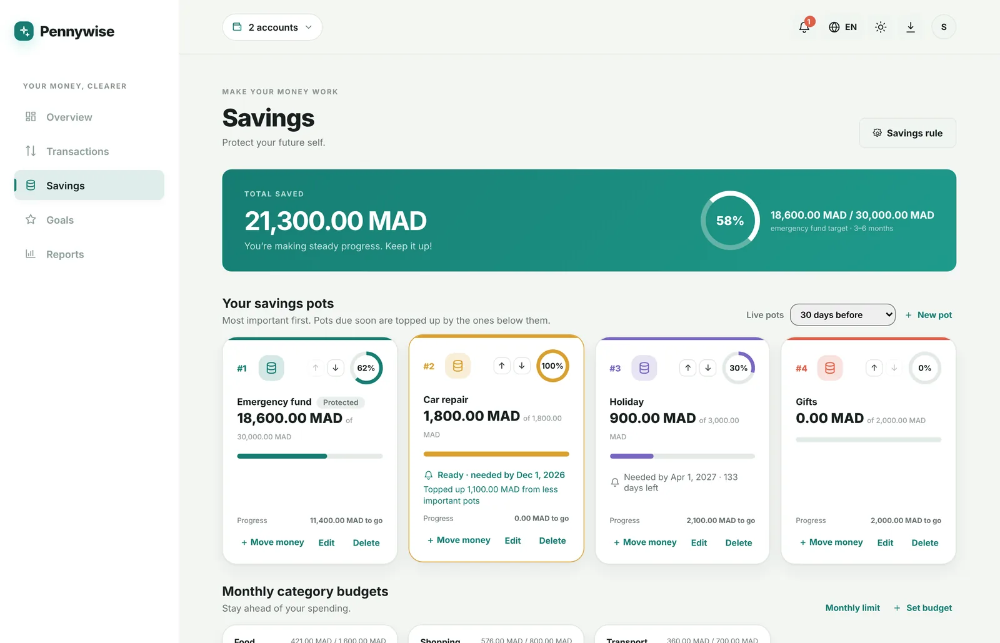</td>
<td>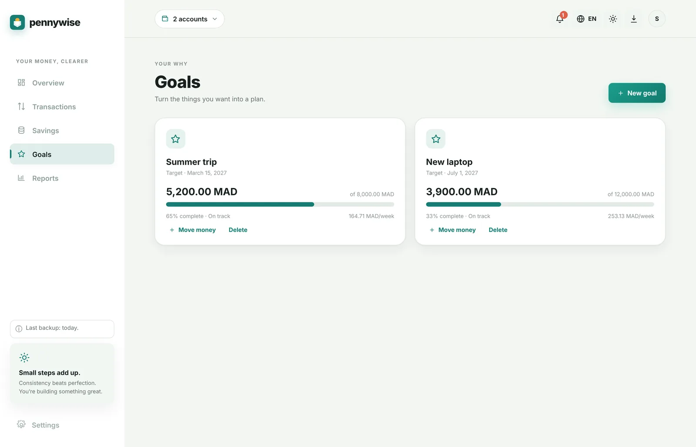</td>
</tr>
<tr>
<td><b>Pots ranked by you</b>: put the most important first. A pot needed soon is highlighted, with a button to fill it from the pots below.</td>
<td><b>Goals</b>: targets with deadlines, the weekly amount needed, and an on-track or catch-up status.</td>
</tr>
<tr>
<td colspan="2" align="center">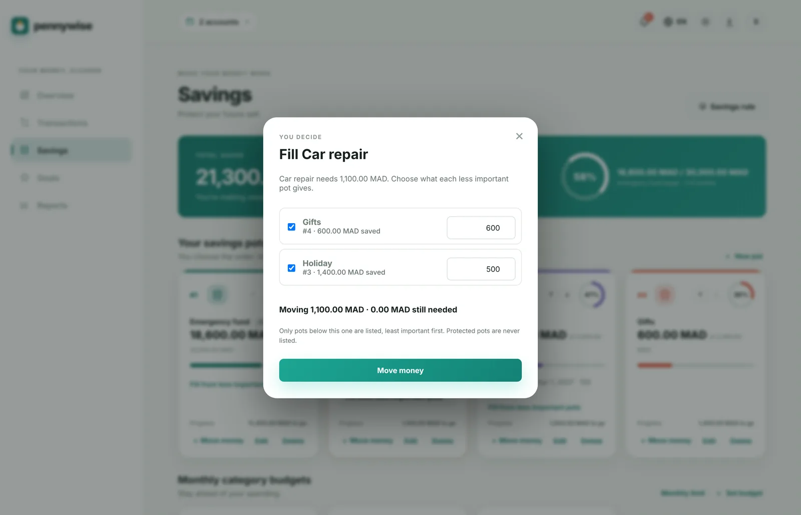<br><b>You decide every move</b>: pick which pots give and how much, then confirm.</td>
</tr>
<tr>
<td>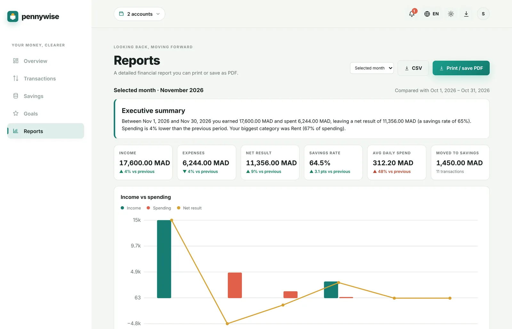</td>
<td>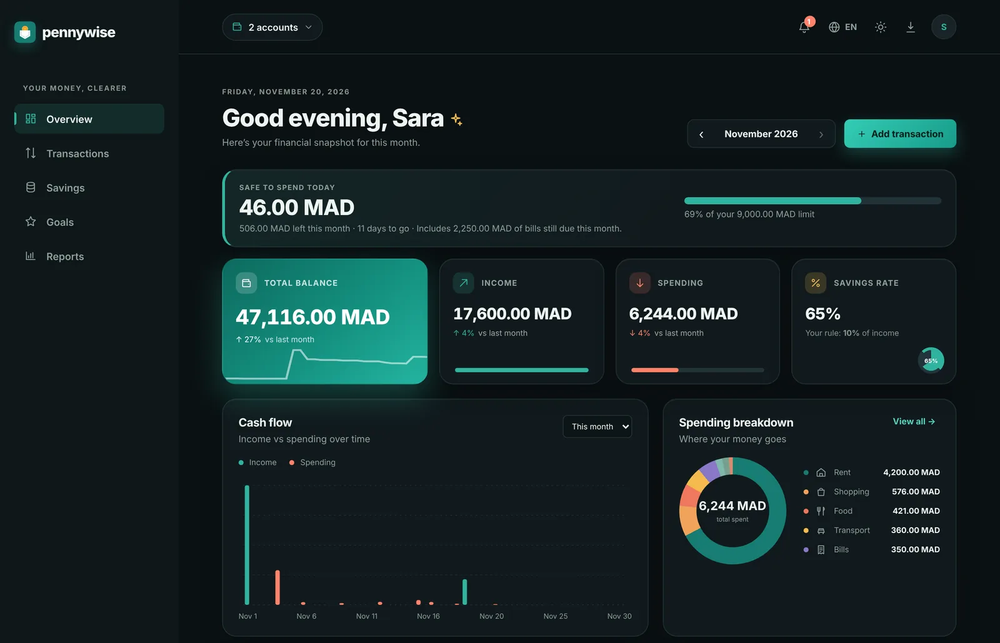</td>
</tr>
<tr>
<td><b>Reports</b>: summary, key figures against the previous period, charts and insights. Print, save as PDF or export CSV.</td>
<td><b>Light and dark themes</b>, one tap away in the top bar.</td>
</tr>
</table>

<table>
<tr>
<td width="62%">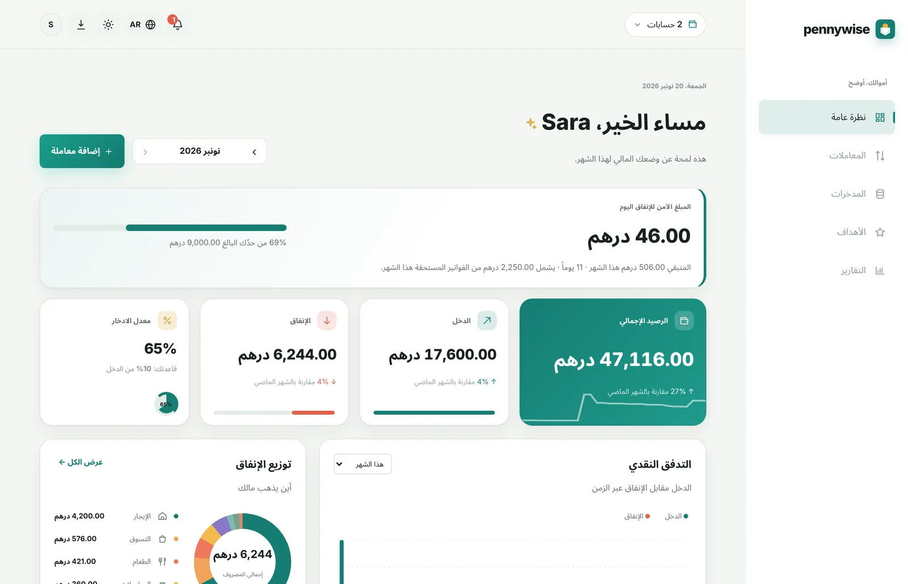</td>
<td width="19%">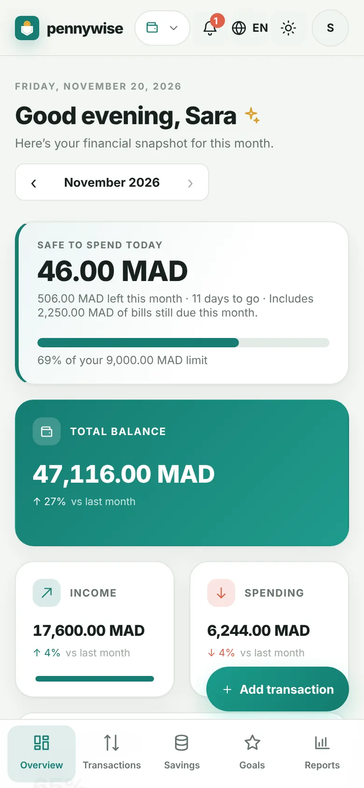</td>
<td width="19%">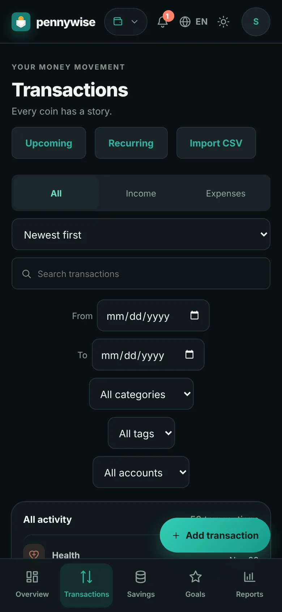</td>
</tr>
<tr>
<td><b>العربية</b>: a full right-to-left interface.</td>
<td colspan="2"><b>Made for phones</b>: bottom navigation and a quick add button.</td>
</tr>
</table>

## Features

**Money in and out**
- Income and expenses with categories, payment method, notes and up to 8 tags
- **Split** one receipt across several categories
- **Multiple accounts** (bank, cash, card) with opening balances. Transfers between accounts never change your total.
- **Bank CSV import**: match the columns, preview, then import. It handles `;` or `,` separators, `DD/MM/YYYY` dates, `1 234,56` amounts and separate debit/credit columns, skips duplicates and guesses categories.
- **Undo** for every change, by button (8 seconds) or `Ctrl/Cmd + Z`

**Planning**
- **Recurring** salary, rent and subscriptions, added automatically on their due date. Pause, resume, end or delete them in the recurring manager.
- **Upcoming bills** with a reminder window (1 to 14 days) and a badge on the bell icon
- **Safe to spend today**: your monthly limit minus what you've spent and the bills still due, divided by the days left
- **Budgets** per category, with warnings at 80% and when over

**Saving**
- **Savings rule**: a percentage or fixed amount of every income goes to your emergency fund when the money arrives
- **Pots ranked by importance**: you choose the order with the arrows; #1 is the most important. A pot can have a "needed by" date, which only works as a reminder: it is highlighted when the date is within 30 days and the pot is still short.
- **Fill from less important pots**: on a short pot, see what each pot below it could give (least important first), change the amounts or untick a pot, then confirm. Money never moves on its own. **Protected** pots are never offered. Every move shows in Savings activity and can be undone.
- **Goals** with progress, deadlines and weekly targets

**Insight**
- Month-by-month overview, cash-flow chart, spending breakdown and a 30-day balance trend
- **Reports** for a week, a month, the last 3/6/12 months, year to date or a custom range, as a printable A4 report or CSV

**Make it yours**
- Custom categories (rename, recolour, change the icon, delete), MAD / EUR / USD / GBP, light and dark themes, three languages, and a short welcome guide

## How balances are counted

- **Balance** = opening balances + income − expenses − money moved to pots and goals, counting only items dated **today or earlier**.
- **Future-dated items** (a bill you add for the 28th, next month's salary) appear in Transactions and Upcoming but don't change any total until their day arrives. An app left open past midnight picks up the new day by itself.
- **Recurring items** create one copy per due date. If you change the date or frequency, the copies are rebuilt on the new schedule. If you correct the amount or category, Pennywise asks whether to update the earlier copies too or keep them as history.
- **Moving money between pots** never changes your balance, and it only happens when you confirm it.
- **The savings rule** follows the income it came from: edit the amount and the transfer is updated, change it to an expense and the transfer is removed.

## Privacy and security

- All data stays in this browser's IndexedDB. Nothing is uploaded, and there is no bank connection.
- The password is hashed on the device with PBKDF2-SHA-256 (310,000 iterations) and works as a **lock screen**. It does **not encrypt** the stored data, and there is **no password recovery**.
- Fonts (Inter, Noto Sans Arabic) are bundled, so the app never contacts an outside server.

> [!IMPORTANT]
> Your data exists only on this device. Use **Settings → Export backup (JSON)** regularly. CSV exports and printed reports are for reading and can't be used to restore.

## Install as an app

Open [pennywise.studio/app.html](https://pennywise.studio/app.html) in Chrome, Edge or Safari and choose **Install** or **Add to Home Screen**. The app then works offline. Updates download in the background the next time you're online.

## Run it locally

There is nothing to build. Serve the folder over `http://localhost`, because browsers only allow secure password hashing on HTTPS or localhost:

```bash
python3 -m http.server 8000
```

Then open <http://localhost:8000/app.html>.

## Development

```bash
npm install
```

```bash
npm test
```

The tests use Node's built-in test runner with jsdom and fake-indexeddb. They cover the data logic, balances and future-dated items, recurring items, accounts, upcoming bills, translations (every visible string must exist in French and Arabic) and accessibility. GitHub Actions runs them on every push.

### Project layout

| File | Purpose |
|---|---|
| `app.html`, `app.js` | App shell and core: storage, lock screen, balances, recurring items, savings rule, rendering, undo |
| `features.js` | Categories, CSV import, filters, tags, splits, recurring manager, safe to spend, welcome guide |
| `accounts.js` | Accounts and transfers between them |
| `upcoming.js` | Upcoming bills, reminders and recurring costs |
| `pots.js` | Pots: importance order, due-date reminders, filling a pot from less important ones, pot editing |
| `report.js` | Reports, printable A4 version and CSV export |
| `i18n.js`, `i18n-landing.js` | English, French and Arabic translations |
| `styles.css`, `design.css` | Base styles, plus the visual layer (cards, charts, motion, mobile navigation) |
| `index.html`, `public.css`, `screens/` | Landing page and its screenshots |
| `sw.js`, `manifest.webmanifest` | Offline support and installation. Bump `CACHE` in `sw.js` when you ship changes. |
| `docs/screenshots/`, `scripts/screenshots.js` | README images and the script that regenerates them with demo data (`--landing` also redoes `screens/`) |
| `docs/brand/`, `scripts/brand/` | [Brand guide](docs/brand/README.md), logo files and the scripts that build the logos and app icons |
| `icon.svg`, `favicon.svg`, `*.png` icons | App icon, browser-tab icon, and home-screen and install icons |

### Publishing

The site is served by GitHub Pages from the `main` branch root at the custom domain in `CNAME`. The landing page is `/` and the app is `/app.html`. To publish a fork, enable **Settings → Pages → Deploy from a branch**, pick `main` and `/ (root)`, and change or remove `CNAME`.
