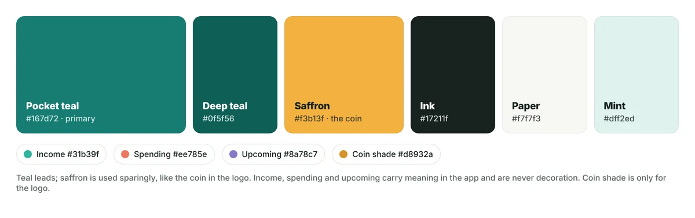

<picture>
  <source media="(prefers-color-scheme: dark)" srcset="pennywise-lockup-dark.svg">
  
</picture>

# Pennywise brand guide

Pennywise is a private finance tracker that keeps everything on your device. The brand says one thing: **your money stays with you.**

## The idea

The logo is a coin dropping into a stitched jeans pocket. The pocket is somewhere close, personal and yours. It isn't a bank, a vault or a cloud. That matches how the app works: no bank connection, no server, nothing leaves the device.

**Tagline:** *Your money, kept in your pocket.*
Supporting line, already in the app: *Small steps add up.*

## Logo files

| File | Use it for |
|---|---|
| [`pennywise-mark.svg`](pennywise-mark.svg) | The default logo: app icon, avatars, social images |
| [`pennywise-lockup.svg`](pennywise-lockup.svg) / [`-dark`](pennywise-lockup-dark.svg) | Logo with the name, on light or dark backgrounds |
| [`pennywise-mark-mono-teal.svg`](pennywise-mark-mono-teal.svg) / [`-white`](pennywise-mark-mono-white.svg) | One colour: photos, print, embossing, single-colour merch |
| [`pennywise-mark-square.svg`](pennywise-mark-square.svg) | Square tile for platforms that round corners themselves |
| [`pennywise-glyph.svg`](pennywise-glyph.svg) | Pocket and coin without the tile, for teal backgrounds |
| [`../../social-card.png`](../../social-card.png) | Link preview image (1200×630) shown when the site is shared |
| [`../../favicon.svg`](../../favicon.svg) | Browser tabs. Drops the stitching and coin ring, which blur below 32 px. |

App icons in the repository root: `icon-192.png`, `icon-512.png`, `icon-maskable-512.png` (Android), `apple-touch-icon.png` (iPhone, 180 px) `favicon-32.png` and `favicon.ico` (16, 32 and 48 px). The pages link the icons with `?v=2`: raise that number when the logo changes, or browsers keep showing the old icon.

### Using the logo

- **Clear space:** keep at least the coin's width free on every side.
- **Minimum size:** 32 px for the full mark, 16 px with `favicon.svg`. Use the lockup only when the name is at least 14 px tall.
- **Backgrounds:** use the teal tile on any plain background. On photos or busy backgrounds, use a one-colour version.
- **Don't:**
  - recolour the tile or the coin
  - stretch or rotate the mark
  - add shadows, outlines or gradients
  - move the coin out of the pocket
  - redraw the wordmark in another font

## Colour



| Name | Hex | Role |
|---|---|---|
| Pocket teal | `#167d72` | Primary: logo tile, main buttons, links, focus |
| Deep teal | `#0f5f56` | Pressed states and text on mint |
| Saffron | `#f3b13f` | The coin. An accent only: highlights and celebrations, never large areas |
| Ink | `#17211f` | Text on light backgrounds |
| Paper | `#f7f7f3` | Light background |
| Mint | `#dff2ed` | Soft fills, selected states |

Income (`#31b39f`), spending (`#ee785e`) and upcoming (`#8a78c7`) carry meaning in the app and are never used for decoration.

## Type

- **Inter** for the interface and the wordmark. The wordmark is Inter ExtraBold, lowercase, tracked −3.5%. It's drawn as outlines in the logo files, so it looks the same everywhere.
- **Noto Sans Arabic** for Arabic text.
- Both are bundled in `fonts/`. Nothing loads from outside servers, which is part of the privacy promise.

## Name

- In the logo: **pennywise**, lowercase, always next to the mark.
- In sentences: **Pennywise**. Never "PennyWise", "PENNYWISE" or "Penny Wise".
- The name stays in Latin letters in French and Arabic.

## Voice

Calm, plain and on your side. Pennywise talks like a sensible friend who is good with money, not like a bank or a coach.

| Do | Don't |
|---|---|
| "Rent is due in 3 days." | "⚠️ URGENT: payment deadline approaching!" |
| "You're 120 MAD over your food budget." | "You overspent again." |
| "Your data stays on this device." | "Military-grade, bank-level, AI-powered security." |
| "Fill from less important pots" | "Optimise your allocation" |

- Sentence case, short sentences, everyday words.
- Say what happens and what to do next. Never shame spending.
- Promise only what the app does. It locks the screen; it doesn't encrypt the data.

## Rebuilding the files

The logo files are generated from one master drawing, so change `scripts/brand/build-logos.py` rather than editing the files by hand.

```bash
pip install fonttools brotli
```

```bash
python3 scripts/brand/build-logos.py
```

```bash
node scripts/brand/render-pngs.js
```

The second step needs Playwright with Chromium. Bump `CACHE` in `sw.js` afterwards so installed apps pick up the new icons.
